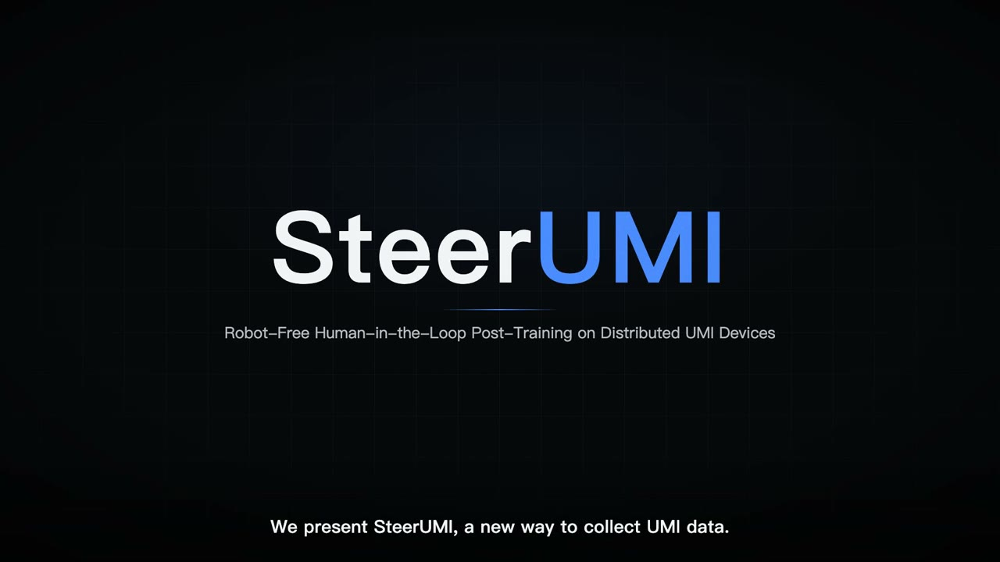

<div align="center">
  <h1>SteerUMI</h1>
  <p><strong>Robot-Free Human-in-the-Loop Post-Training on Distributed UMI Devices</strong></p>
  <p><a href="https://qyrotech.github.io/steerumi-website/">Project Page &amp; Video Demos →</a></p>
  <a href="https://qyrotech.github.io/steerumi-website/">
    
  </a>
</div>

## About SteerUMI

SteerUMI is a framework for post-training vision-language-action (VLA) models without running physical robots during data collection. Operators use handheld Universal Manipulation Interface (UMI) devices to collect demonstrations in parallel. Policy feedback and augmented reality help them target situations where the policy struggles, and the resulting corrections are used to improve the policy over successive rounds.

This repository contains the project website. Visit the [project page](https://qyrotech.github.io/steerumi-website/) for the method overview, demonstrations, experimental results, and BibTeX.

## 本地开发

推荐 **Node.js 24 LTS**（最低 22.12）。项目使用已有、锁定的依赖，不需要另建 Astro 工程。

```bash
npm install
npm run dev
```

打开终端显示的地址，默认 `http://localhost:4321`。

```bash
npm run build       # Astro 类型检查 + 静态构建，输出 dist/
npm test            # 检查生成页面的结构、资源路径和媒体配置
npm run preview     # 本地预览生产产物
```

可设置 `ASTRO_TELEMETRY_DISABLED=1` 关闭 Astro 遥测。页面使用系统字体，无需请求 Google Fonts。
